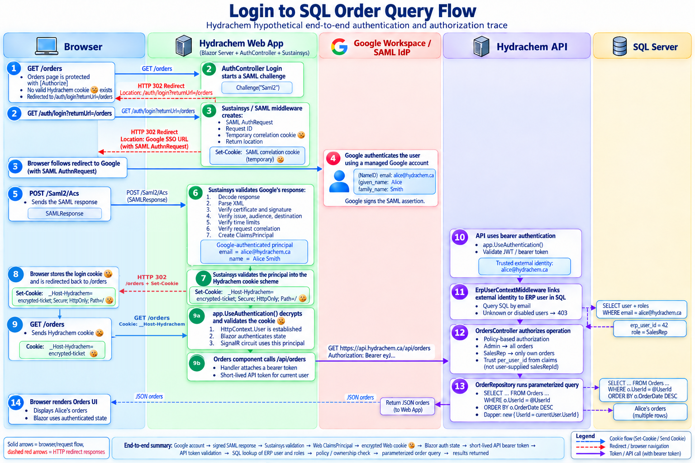

# SAML and Auth

## 1. The mental model

Keep four responsibilities separate:

- **Authentication:** Who is the user? Google Workspace proves the external identity through SAML.
- **Provisioning:** Which active example.com user corresponds to that external identity?
- **Authorization:** What may that example.com user do?
- **Session:** How is the authenticated user remembered between requests?

SAML solves authentication. example.com still owns provisioning and authorization, while its authentication cookie maintains the browser session.

## 2. Essential SAML terms

- **Identity Provider (IdP):** Google Workspace. It authenticates the user and signs the SAML response.
- **Service Provider (SP):** example.com Web. It requests and validates the external login.
- **Assertion Consumer Service (ACS):** The middleware-owned example.com endpoint that receives the SAML response, commonly `/Saml2/Acs`.
- **Entity ID:** The exact identifier of an IdP or SP. It often looks like a URL but is primarily a name.
- **Metadata:** XML that publishes entity IDs, endpoints, certificates and supported bindings.

example.com must not receive or store the user's Google password.

## 3. Login in one paragraph

example.com Web challenges the SAML handler, which redirects the browser to Google. Google authenticates the user and returns a signed SAML response through the browser to the ACS. The middleware validates it, creates a `ClaimsPrincipal`, and signs that principal into example.com's cookie scheme. Later browser requests carry the example.com cookie; they do not carry a new SAML response.

Sections 22 and 24 contain the authoritative detailed trace.

## 4. What must be validated

Use maintained SAML middleware rather than handwritten XML or cryptography. It must validate at least:

- Google's signature and trusted signing certificate
- Issuer, audience and ACS destination
- Assertion validity times
- Correlation with the request example.com initiated
- Replay protections supported by the middleware

HTTPS remains mandatory. A valid XML signature does not protect the rest of the connection.

## 5. The two temporary proofs

The SAML response and the example.com cookie serve different purposes:

- Google signs the short-lived SAML response so example.com can verify the login.
- example.com Web protects its own cookie with ASP.NET Core Data Protection so it can recognize later browser requests.

The correlation cookie used during SAML login is also different from the final authentication cookie. Section 22 explains these cookies in detail.

## 6. Claims, roles and policies

A claim is a fact in the authenticated principal, such as `email`, `erp_user_id` or a role. A role is a claim representing a broad user category. A policy expresses an application permission such as `Orders.Read` or `Users.Manage`.

A role returned only inside a DTO does not make `[Authorize(Roles = "Admin")]` work; it must be part of the trusted principal at the point where authorization runs. Prefer policies over scattered role strings, and keep API authorization authoritative.

## 7. Current repository findings

The current code contains the right pieces but assigns them to inconsistent security boundaries:

- API `Program.cs` registers cookie authentication and Sustainsys SAML, although the Web application owns browser navigation and the interactive session.
- `AuthController` can start a SAML challenge, but its custom ACS action does not validate SAML. The middleware must own the real ACS endpoint.
- The hand-written metadata response is a placeholder. Metadata must come from the actual SAML configuration so its entity ID, endpoints and certificates cannot drift.
- `AuthService` maps an external email to a user and returns roles in a DTO, but that alone does not create trusted role claims.
- `AuthRepository` and `UserRepository` overlap, while SAML identity and legacy password membership coexist without a clear policy.
- Web `UserSessionService` stores email and roles as UI state; it is not an authentication or authorization boundary.
- `Routes.razor` uses `RouteView`, so authenticated routing is not centrally enforced.

For an internal Workspace ERP, use pre-provisioned SAML accounts by default. If local password accounts or an emergency administrator are required, define and secure that as a separate, explicit design.

## 8. Target responsibility split

The coherent target for the current two-application deployment is:

```text
Browser
  -> SAML login + example.com cookie
example.com Web
  -> short-lived bearer token
example.com API
  -> Azure SQL
```

example.com Web should be the SAML SP and own the browser cookie. The API should authenticate bearer tokens and enforce permissions and record ownership.

SAML does not itself issue the API bearer token. The team must select a trusted token issuer or exchange mechanism. An alternative is a deliberately designed same-origin BFF/gateway or a single combined host; do not assume a server-side `HttpClient` automatically forwards the browser's API cookie. Pooled cookie handlers can also risk cross-user cookie leakage.

## 9. Web authentication requirements

Web configuration should:

- Make the example.com cookie the default authentication scheme and SAML the challenge scheme.
- Configure example.com's entity ID and Google's reviewed metadata/certificate.
- Set the cookie to `Secure`, `HttpOnly`, an appropriate `SameSite` value, and a reasonable lifetime.
- Persist and share Data Protection keys across instances of the same Web application.
- Call `UseAuthentication()` before `UseAuthorization()`.
- Apply a fallback policy requiring authentication where appropriate.
- Add cascading authentication state for Blazor.

The exact Sustainsys APIs depend on the installed package version. The conceptual code appears in section 24.

## 10. Login and logout endpoints

The Web login endpoint should validate that `returnUrl` is local and then return a SAML `Challenge`. This prevents an open redirect after authentication.

Logout should be a protected POST with antiforgery protection and should clear the example.com cookie. Google SAML Single Logout is a separate feature; secure local logout is the appropriate first milestone.

## 11. Linking Google identity to a example.com user

After SAML validation, use the trusted email or stable external identifier to find an active, pre-provisioned example.com account. Add the internal `erp_user_id` and, where needed, roles as trusted claims before authorization evaluates them.

Recommended behavior:

1. An administrator creates and assigns roles to the example.com user.
2. Google authenticates the person.
3. example.com maps the validated identity to the existing active account.
4. Unknown or disabled accounts are denied.

Never default an unknown Google identity to `Customer`. Authentication by Google is not authorization to use the ERP.

## 12. Protecting Blazor pages

Use `CascadingAuthenticationState` and `AuthorizeRouteView`. Pages can require `[Authorize]` or a policy, and `AuthorizeView` may conditionally render controls.

UI checks improve navigation; they are not a security boundary. Every corresponding API operation must independently enforce the permission.

## 13. Protecting the API

The API should validate a bearer token's signature, issuer, audience and expiration. Tokens must be short-lived, and secrets must never be placed in a JWT because a signed JWT is not necessarily encrypted.

After token validation, resolve the external identity to the active ERP user and current database roles. This keeps provisioning, disabling and role changes under example.com's control. Require an `erp_user_id` claim or equivalent provisioned-user policy before business endpoints run.

## 14. Never trust a client-supplied current-user ID

For operations concerning the caller, derive the user ID from the authenticated principal, not from JSON, query parameters or UI state. The client supplies business input; the server-established `erp_user_id` supplies ownership.

An administrator may explicitly target another user only through an operation whose policy authorizes that behavior.

## 15. Enforce record-level authorization

A role may permit the type of operation without granting access to every record. For each order, customer or similar resource, verify ownership or another domain rule on the server.

Typical results are:

- **401:** No valid authentication.
- **403:** Authenticated but not permitted.
- **404:** The resource is absent, or its existence is intentionally concealed.

Centralize repeated ownership rules in authorization handlers or domain services. Section 24 shows the order-query risk and the trusted-user-ID pattern.

## 16. Retire UserSessionService as a security authority

Security decisions must come from the authenticated `ClaimsPrincipal` exposed through ASP.NET/Blazor authentication state. `UserSessionService` may retain presentation-only data such as display name, avatar or theme, but it must not decide whether the user is an administrator or owns a resource.

## 17. Configuration, certificates and keys

Keep nonsecret SAML settings in configuration and override them per environment with values such as:

```text
Saml2__EntityId
Saml2__IdpEntityId
Saml2__MetadataLocation
```

Protect private keys and secrets with Azure Key Vault. Although Google's signing certificate is public, store the reviewed trusted copy in controlled configuration and plan certificate rotation.

Use distinct settings—and preferably distinct Google SAML applications—for local development, staging and production because their entity IDs and callback URLs differ.

## 18. Development authentication

Keep development login behind all three conditions:

```text
Local environment
AND DevAuth.Enabled is true
AND host is localhost
```

Do not expose it merely because a deployed environment happens to use `ASPNETCORE_ENVIRONMENT=Development`. Prefer explicit environment names such as `Local`, `Staging` and `Production`.

## 19. Prefer SP-initiated login first

In SP-initiated login, example.com creates the request and can correlate Google's response with it. This should be the initial supported flow.

IdP-initiated login begins from a Google Workspace tile and returns an unsolicited response. Keep `AllowUnsolicitedAuthnResponse` disabled unless that launcher flow is an explicit requirement; enable and test it deliberately later.

## 20. Minimum security tests

Unit and API integration tests should use a fake authentication handler and verify:

- unauthenticated requests return 401 and disallowed roles return 403;
- administrators and ordinary users receive only their permitted resources;
- a request-supplied user ID cannot impersonate another user;
- unknown and disabled users are denied;
- database roles become effective claims or policies.

End-to-end tests against a dedicated Google Workspace SAML application should cover successful login, wrong entity ID/audience, unassigned users, expired assertions, logout, and certificate rotation. Test application behavior around Sustainsys; do not reimplement or unit-test its cryptography.

## <mark>22. Where is the cookie created?</mark>

All the security is in the cookies!

The browser is not permanently linked to Alice’s email or IP address. The browser is simply a messenger that carries temporary cryptographic proof between Google and example.com. Here is exactly what happens.

On the second redirect, Google sends example.com a signed message saying:

```
I, Google Workspace, successfully authenticated
alice@example.com.ca.

This response belongs to example.com login request #ABC123.

Signed: Google
```

example.com verifies Google’s signature. If valid, example.com creates its own login cookie and places it in Alice’s browser.

From then on, the example.com cookie—not Alice’s IP address—is what tells example.com that this browser session represents Alice.

### Full example

#### 1. Alice clicks Login

Alice’s browser requests:

```
GET https://app.example.com.ca/auth/login
```

example.com creates a unique <mark>login request ID</mark>:

```
Login request ID: ABC123
```

example.com remembers this request using a <mark>short-lived correlation cookie</mark>:

```
Set-Cookie: SamlCorrelation=random-secret-789
```

It redirects the browser to Google with a SAML request containing:

```
Request ID: ABC123
Application: example.com
Return address: https://app.example.com.ca/Saml2/Acs
```

At this moment, example.com has not identified Alice. It only knows that one browser started login request `ABC123`.

#### 2. The browser arrives at Google

Google asks:

```
Which Google account are you using?
```

Alice enters:

```
alice@example.com.ca
```

Then she enters her password and possibly an MFA code.

Google checks the password against Alice’s Google Workspace account record:

```
Google Workspace account
-------------------------
Primary email: alice@example.com.ca
Password hash: ...
Account enabled: Yes
MFA: Passed
example.com application assigned: Yes
```

Google now knows that the human using this browser successfully proved control of `alice@example.com.ca`.

It did not determine this using the IP address. It determined it using Alice’s credentials, MFA and possibly an existing Google session cookie.

#### 3. Google creates signed proof

Google creates a SAML response approximately saying:

```
Issuer:
    Google Workspace

Authenticated person:
    alice@example.com.ca

Authentication time:
    2026-10-10 14:30 UTC

Intended application:
    example.com

Return address:
    https://app.example.com.ca/Saml2/Acs

In response to:
    ABC123

Valid until:
    2026-10-10 14:35 UTC
```

Google signs that information using Google’s private key. The important identity field is commonly:

```xml
<NameID>alice@example.com.ca</NameID>
```

It may also provide attributes:

```xml
<Attribute Name="email">
    <AttributeValue>
        alice@example.com.ca
    </AttributeValue>
</Attribute>
```

#### 4. The browser carries that proof back

Technically, this is commonly an automatic HTML form POST rather than an ordinary redirect:

```
POST https://app.example.com.ca/Saml2/Acs

SAMLResponse=PHNhbWxwOlJlc3BvbnNl...
```

The browser does not create or understand this response. It only transports it. Think of the browser as a courier carrying a sealed envelope from Google to example.com. The browser could try to modify the envelope, but then Google’s signature would no longer be valid.

#### 5. example.com verifies three connections

example.com verifies:

##### Google → identity

Google’s signature proves:

```
Google says this is alice@example.com.ca.
```

##### Response → example.com

The audience and destination prove:

```
This response was created for example.com,
not for another application.
```

##### Response → original browser login

The response contains:

```
InResponseTo = ABC123
```

The browser also returns example.com’s short-lived correlation cookie:

```
SamlCorrelation=random-secret-789
```

example.com checks that these match the login it started. So the correlation is approximately:

```
Browser starts request ABC123
        ↓
Google returns response for ABC123
        ↓
Browser also returns correlation cookie
        ↓
example.com verifies they belong together
```

This prevents an attacker from easily taking an unrelated SAML response and inserting it into a different login attempt.

#### 6. example.com creates its own cookie

After accepting Google’s response, example.com creates a local identity:

```
Email: alice@example.com.ca
Authenticated by: Google Workspace
Authenticated: true
```

It then sends a new example.com cookie:

```
Set-Cookie: __Host-example.com=encrypted-alice-ticket;
            Secure;
            HttpOnly;
            Path=/
```

The browser now has two unrelated kinds of cookies:

```
Google cookie
    Used when communicating with google.com

example.com cookie
    Used when communicating with app.example.com.ca
```

Google cannot normally read the example.com cookie, and example.com cannot read the Google cookie.

#### 7. Browser opens the example.com homepage again

The browser requests:

```
GET https://app.example.com.ca/
Cookie: __Host-example.com=encrypted-alice-ticket
```

example.com decrypts the cookie and reconstructs:

```
This request belongs to:
    alice@example.com.ca
```

That is why Alice is allowed in this time. The browser itself does not send:

```
Trust me, I am Alice.
```

It sends the protected cookie example.com issued only after Google successfully authenticated Alice.

### What exactly is linked to what?

There are two temporary links:

```
During SAML login:

Google-verified account
    alice@example.com.ca
        ↓
Signed SAML response
        ↓
example.com login request ABC123
        ↓
Browser's correlation cookie
```

Then, after login:

```
example.com identity
    alice@example.com.ca
        ↓
Encrypted example.com authentication cookie
        ↓
Stored in this browser
```

So the answer is:

> example.com links Alice’s verified Google identity to a protected cookie stored in the browser—not to the browser’s IP address.

### Is the browser itself trusted?

No. The cookie is trusted because example.com created and cryptographically protected it.

If Alice logs in from Chrome and Firefox, both browsers can receive separate example.com cookies:

```
Chrome cookie  → Alice
Firefox cookie → Alice
Phone cookie   → Alice
```

Each is a separate authenticated session.

If Alice’s IP changes while she is using the application, she normally remains logged in because her valid cookie is still present.

### What if someone steals the cookie?

A valid authentication cookie is effectively a temporary key to Alice’s session. If an attacker steals it, the attacker may be able to impersonate Alice until it expires or is revoked.

That is why authentication cookies need:

- HTTPS
- `Secure`
- `HttpOnly`
- Appropriate `SameSite`
- Short/reasonable expiration
- Protection against cross-site attacks
- Secure computers and browsers
- Server-side revocation or revalidation for sensitive systems

The cookie being encrypted does not prevent theft. Encryption prevents reading and modification. HTTPS, `HttpOnly`, secure browser behavior and expiration help prevent or limit theft.

In one sentence:

> Alice proves her identity to Google using credentials; Google gives example.com signed proof of Alice’s email; example.com verifies that proof and gives Alice’s browser a example.com cookie representing her authenticated session.

### Who signs what?

| Object             | Created by           | Protected by                 | Verified by                                            |
| ------------------ | -------------------- | ---------------------------- | ------------------------------------------------------ |
| SAML response      | Google Workspace     | Google’s private signing key | example.com using Google’s public certificate            |
| Web session cookie | example.com Web        | ASP.NET Data Protection key  | example.com Web (given to and recieved form the browser) |
| API bearer token   | Trusted token issuer | Issuer’s signing key         | example.com API                                          |

### Azure key storage matters

If each Azure App Service instance generates unrelated Data Protection keys, one instance might be unable to decrypt a cookie created by another. A restart may also sign everyone out.

Therefore, production Data Protection keys should be stored persistently and shared between instances of the same Web application.

They should not ordinarily be shared with the API if the API uses bearer authentication

## 24. Complete hypothetical trace: login to SQL order query

### Stage 1: User opens the orders page

The browser requests:

```
GET https://app.example.com.ca/orders
```

The final `Routes.razor` would use `AuthorizeRouteView`:

```html
<AuthorizeRouteView RouteData="routeData">
    <NotAuthorized>
        <RedirectToLogin />
    </NotAuthorized>
</AuthorizeRouteView>
```

The orders page might have:

```c#
@attribute [Authorize]
```

<mark>There is no valid example.com cookie, so the user is redirected to:</mark>

```
/auth/login?returnUrl=/orders
```

### Stage 2: Web AuthController starts SAML

Hypothetical new file:

```
example.comERP.Web/Controllers/AuthController.cs
```

Possible code:

```c#
[AllowAnonymous]
[HttpGet("/auth/login")]
public IActionResult Login(string? returnUrl = "/")
{
    var safeReturnUrl =
        Url.IsLocalUrl(returnUrl) ? returnUrl : "/";

    return Challenge(
        new AuthenticationProperties
        {
            RedirectUri = safeReturnUrl
        },
        "Saml2");
}
```

This does not authenticate the user. It tells the SAML handler:

> Start a SAML authentication challenge.

### Stage 3: SAML middleware creates the request

Hypothetical Web `Program.cs`:

```c#
builder.Services
    .AddAuthentication(options =>
    {
        options.DefaultScheme = "example.comCookie";
        options.DefaultChallengeScheme = "Saml2";
    })
    .AddCookie("example.comCookie", options =>
    {
        options.Cookie.Name = "__Host-example.com";
        options.Cookie.HttpOnly = true;
        options.Cookie.SecurePolicy =
            CookieSecurePolicy.Always;
        options.Cookie.SameSite =
            SameSiteMode.Lax;
    })
    .AddSaml2(options =>
    {
        options.SPOptions.EntityId =
            new EntityId(configuration["Saml2:EntityId"]!);

        // Register Google's reviewed metadata/certificate.
    });
```

The SAML handler creates:

- A SAML `AuthnRequest`
- <mark>A random request identifier (#ABC123)</mark>
- A temporary <mark>correlation cookie</mark>
- <mark> A return location</mark>

Then it redirects the browser to Google.

<mark>The temporary correlation cookie is different from the final login cookie.</mark> It helps example.com verify that the returning response belongs to a login it initiated.

### Stage 4: Google authenticates the user

Google identifies the person using their managed Google account.

Google then produces:

```
NameID = alice@example.com.ca
email = alice@example.com.ca
given_name = Alice
family_name = Smith
```

Google signs the SAML assertion.

### Stage 5: Browser returns to the ACS

The browser submits Google’s response to something like:

```
POST /Saml2/Acs
```

This endpoint is handled by Sustainsys middleware. There should not be a handwritten controller attempting to validate the SAML XML.

### Stage 6: Sustainsys validates Google’s response

Sustainsys:

1. Base64-decodes the response.
2. Parses the XML.
3. Finds Google’s certificate.
4. Verifies the signature.
5. Verifies issuer, audience and destination.
6. Verifies time limits.
7. Verifies request correlation.
8. <mark>Creates a `ClaimsPrincipal` cookie.</mark>

At this point, it represents a Google-authenticated identity:

```
email = alice@example.com.ca
name = Alice Smith
identity provider = Google Workspace
```

It does not yet necessarily mean Alice is an authorized ERP employee.

### Stage 7: Web creates its cookie

The SAML remote-authentication handler signs the resulting principal into the configured cookie scheme.

Conceptually, this happens:

```c#
await HttpContext.SignInAsync(
    "example.comCookie",
    googlePrincipal);
```

The cookie handler returns:

```
Set-Cookie: __Host-example.com=encrypted-ticket;
            Secure;
            HttpOnly;
            Path=/
```

The browser stores it and returns to:

```
/orders
```

### Stage 8: Cookie becomes HttpContext.User

On the new request:

```text
GET /orders
Cookie: __Host-example.com=encrypted-ticket
```

Hypothetical Web `Program.cs` contains:

```c#
app.UseAuthentication();
app.UseAuthorization();
```

The first line:

```c#
app.UseAuthentication();
```

decrypts and verifies the cookie and sets:

```c#
HttpContext.User
```

This is the “line that receives the cookie,” conceptually. `AuthController` does not manually receive it.

The Blazor Server circuit then receives an authentication state based on that principal. Microsoft notes that server-side Blazor establishes authentication when the SignalR circuit connects and reevaluates it on reconnection. [Blazor authentication documentation](https://learn.microsoft.com/en-us/aspnet/core/blazor/security/?view=aspnetcore-10.0)

### Stage 9: The Orders component calls the API

Suppose `Orders.razor` performs:

```c#
var orders = await Http.GetFromJsonAsync<List<OrderDto>>(
    "/api/orders");
```

A hypothetical handler would attach an API token:

```c#
example.comERP.Web/Authentication/ApiBearerTokenHandler.cs
protected override async Task<HttpResponseMessage> SendAsync(
    HttpRequestMessage request,
    CancellationToken cancellationToken)
{
    var token = await tokenProvider
        .GetAccessTokenForCurrentUserAsync(cancellationToken);

    request.Headers.Authorization =
        new AuthenticationHeaderValue("Bearer", token);

    return await base.SendAsync(request, cancellationToken);
}
```

The resulting API request becomes:

```
GET https://api.example.com.ca/api/orders
Authorization: Bearer eyJ...
```

The token might contain only externally proven information:

```json
{
  "iss": "trusted-example.com-token-issuer",
  "aud": "example.com-api",
  "sub": "google-workspace:alice@example.com.ca",
  "email": "alice@example.com.ca",
  "exp": 1791590400
}
```

It should be short-lived. Roles can remain database-authoritative rather than being trusted indefinitely from the token.

### Stage 10: API validates the bearer token

Final API `Program.cs` would register bearer authentication instead of SAML:

```c#
builder.Services
    .AddAuthentication("Bearer")
    .AddJwtBearer("Bearer", options =>
    {
        options.Authority =
            configuration["Authentication:Authority"];

        options.Audience = "example.com-api";
    });
```

Pipeline:

```c#
app.UseAuthentication();

app.UseMiddleware<ErpUserContextMiddleware>();

app.UseAuthorization();

app.MapControllers();
```

After `UseAuthentication`, the API knows:

```
This token is valid.
It represents Google identity alice@example.com.ca.
```

But it still needs to establish the ERP user.

### Stage 11: API links the identity to SQL

Hypothetical:

```c#
Authentication/ErpUserContextMiddleware.cs
public async Task InvokeAsync(
    HttpContext context,
    IUserRepository users,
    IRoleRepository roles)
{
    if (context.User.Identity?.IsAuthenticated == true)
    {
        var email = context.User.FindFirstValue(
            ClaimTypes.Email);

        var user = await users.GetUserByEmailAsync(email!);

        if (user is not null && user.IsActive)
        {
            var identity =
                (ClaimsIdentity)context.User.Identity;

            identity.AddClaim(
                new Claim("erp_user_id",
                    user.UserId.ToString()));

            var userRoles =
                await roles.GetUserRolesAsync(user.UserId);

            foreach (var role in userRoles)
            {
                identity.AddClaim(
                    new Claim(
                        ClaimTypes.Role,
                        role.RoleName!));
            }
        }
    }

    await next(context);
}
```

This is where external identity becomes application identity:

```c#
Before SQL lookup:
    email = alice@example.com.ca

After SQL lookup:
    email = alice@example.com.ca
    erp_user_id = 42
    role = SalesRep
```

A final authorization policy should also require a provisioned ERP user:

```c#
options.AddPolicy("ProvisionedUser", policy =>
{
    policy.RequireAuthenticatedUser();
    policy.RequireClaim("erp_user_id");
});
```

Unknown or disabled users receive 403.

### Stage 12: OrdersController authorizes the operation

<mark>The current controller already has:</mark>

```c#
[Authorize]
```

And:

```c#
[Authorize(Roles = "Admin,SalesRep")]
```

A final version would preferably use policies:

```c#
[Authorize(Policy = Permissions.OrdersRead)]
[HttpGet]
public IActionResult GetOrders()
```

A `CurrentUser` service would read the trusted claim:

```c#
public int UserId =>
    int.Parse(
        httpContextAccessor.HttpContext!.User
            .FindFirstValue("erp_user_id")!);
```

The controller would then ignore a salesperson-supplied `salesRepId`:

```c#
public IActionResult GetOrders()
{
    if (currentUser.IsAdmin)
    {
        return Ok(
            orderRepository.GetAllOrdersWithStats());
    }

    return Ok(
        orderRepository
            .GetOrdersBySalesRepIdWithStats(
                currentUser.UserId));
}
```

That is important because the current implementation accepts:

```c#
GetOrders(int? salesRepId, int? customerId)
```

<mark>A salesperson could potentially request another salesperson’s ID. The UI restricting the value is not sufficient.</mark>

### Stage 13: OrderRepository accesses SQL Server

For an administrator, the controller calls:

```c#
GetAllOrdersWithStats()
```

For a salesperson, it calls:

```c#
GetOrdersBySalesRepIdWithStats(currentUser.UserId)
```

That method opens a SQL connection:

```c#
using var connection =
    _connectionFactory.CreateConnection();
```

And runs parameterized SQL:

```sql
SELECT ...
FROM Orders AS o
LEFT JOIN UserProfiles AS u
    ON o.UserId = u.UserId
LEFT JOIN Status AS s
    ON o.StatusId = s.StatusId
LEFT JOIN Customers AS c
    ON o.CustomerId = c.CustomerId
WHERE o.UserId = @UserId
ORDER BY o.OrderDate DESC;
```

Dapper receives:

```c#
new { UserId = currentUser.UserId }
```

SQL Server returns only Alice’s orders. Dapper turns the rows into `OrderWithStats` objects, the controller returns JSON, and the Web component renders them.

## 25. The full chain in one diagram


